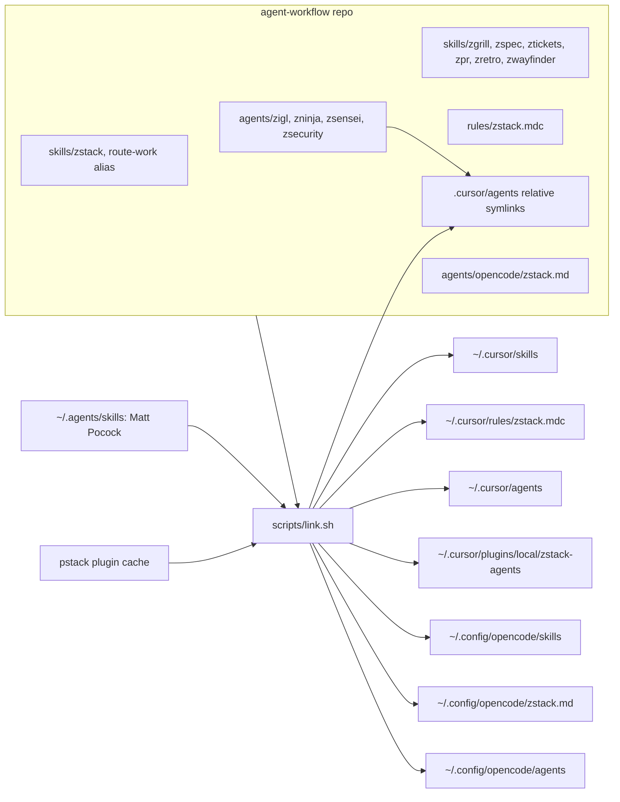
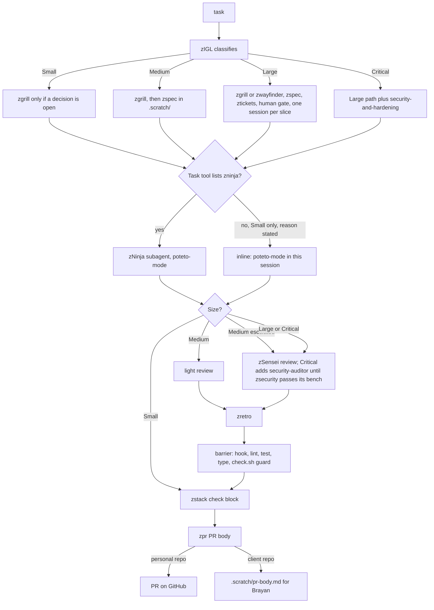
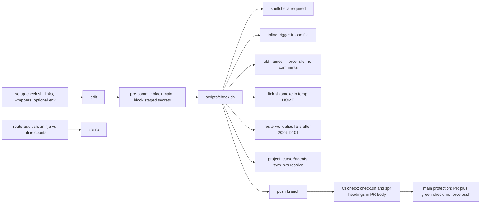

# Architecture

How this repo is wired and how a task moves through zStack. `skills/zstack/SKILL.md` is the source of truth; this page only draws it.

## 1. Repo to user folders

Project agent registration (issue #58, symlinks, the plugin copy, and the zsensei model argument) is `skills/zstack/SKILL.md`. `scripts/link.sh` restores those project links when they are missing or already symlinks, and it links rules, agents, and in-repo skills into the folders the IDE and OpenCode read. A skill pin links that skill at the rev in `skills/versions`. Other skills stay on the checkout. It is idempotent, removes old links that point into this repo (route-work rule, implementer, code-reviewer, coordinator), sets `core.hooksPath` to `.githooks`, removes broken symlinks (only symlinks, never real folders) in `~/.cursor/skills` and `~/.config/opencode/skills`, and mirrors Matt's skills from `~/.agents/skills` and pstack skills when the name is free.

- `skills/zwrite/SKILL.md` writes `AGENTS.md` and files under `rules/`.

## 2. Task flow

Sizes, the inline trigger, the slice loop, client pre-stage, review gates, and delivery are `skills/zstack/SKILL.md`. Client work never uses `opencode/*` models (`agents/opencode/zstack.md`). The diagram below is the map.

## 3. Guardrails

Each guard runs at a different moment. The pre-commit hook and CI run the same `scripts/check.sh`. GitHub protects `main`: a PR with a green `check` is the only way in. `setup-check.sh` and `route-audit.sh` are manual reports. `route-audit.sh` exits 1 when a zstack session has no parseable size (`size undetected`). The canonical line is `zstack: <Small|Medium|Large|Critical>, <full|partial> verifiable — <reason>`; older variants (`Clasificación **Small**`, `size: Small`) still count, reported as `legacy format`.

## Verified statechart

`docs/statechart/` holds a TLA+ model of this flow, checked with TLC via pstack's `/statechart` (decision #23). With option B every rule holds when the agent obeys the skill text; with no barriers (today) each rule breaks, so all six hold by text, not by a blocking hook. CI job `tla` reruns TLC when the skill or the model changes. See [docs/statechart/README.md](statechart/README.md) and [chart.mmd](statechart/chart.mmd).

## Hard barriers (opt-in)

| Barrier | What blocks | Install (Brayan) | Bypass |
|---|---|---|---|
| `hooks/client-guard/pre-push` | `git push` from any repo under the clients root (`CLIENTS_ROOT`, or `$HOME/Clients` when that is unset) or to a remote matching `CLIENT_GUARD_HOSTS` (default `bitbucket.org gitlab.`) | In each client repo, copy this repo's `hooks/client-guard/pre-push` into `"$(git rev-parse --git-path hooks)/pre-push"` (repos with husky or a local `core.hooksPath`: add it there instead). The hook does not read the client map | `CLIENT_PUSH_OK=brayan git push`, or `--no-verify` |
| `hooks/client-guard/pre-commit` | `git commit` in the same repos (path under the clients root, or an `origin` matching `CLIENT_GUARD_HOSTS`) | Same as pre-push, file `pre-commit`. Husky repos (`core.hooksPath=.husky`): add this repo's `hooks/client-guard/pre-commit` as a line in a local, untracked `.husky/pre-commit` only if Brayan wants it; never commit it to the client repo | `CLIENT_PUSH_OK=brayan git commit`, or `--no-verify` |
| `hooks/client-guard/push-checks` | On a client push with `CLIENT_PUSH_OK=brayan`, blocks a changed config path, an added RUT or an email outside the allow list, a gitleaks finding, a branch name without a ticket id, and a config path against the main ref when the branch name ends in `-main` | Copy `push-checks` next to the installed `pre-push`. If the file is absent the hook prints `client-guard: push-checks not installed, content checks skipped` and allows the push | `CLIENT_ALLOW_CONFIG=1`, `CLIENT_ALLOW_SENSITIVE=1`, `CLIENT_ALLOW_BRANCH=1`, `CLIENT_ALLOW_MAIN_CONFIG=1`, `CLIENT_SKIP_GITLEAKS=1` |
| Agent identity for merges | Nothing yet: the agent's GitHub token is Brayan's admin account | Give the agent its own GitHub identity (machine user or GitHub App) with write access; add a ruleset on `main` with **Restrict updates** and bypass list = repository admin (Brayan) | Brayan's account |

`scripts/setup-check.sh` reports them (`client-guard`, `client-guard pre-commit`, `merge-guard`, `local-exclude`, `client identity`). `local-exclude` is the count of client repos whose `info/exclude` contains `.scratch/` and `.atl/`; the same run appends any missing line and does not touch `.gitignore`. A mapped client fails when `git_email` is set and the effective `user.email` is not exactly that value. It warns when `git_email` is unset, `git_email_domains` is set, and the email matches none of those suffixes. A repo under the clients root with no matching `root` gets no identity fail or warn, and it still counts for client-guard and local-exclude. If the pre-commit guard is installed, it blocks the local slice commit, and the agent stops instead of bypassing it. Slice commits and the pre-push gate are section 5 of `skills/zstack/SKILL.md`. Illustrative checks a repo may already define: .NET commit `dotnet build` + `dotnet test --filter <slice>`, pre-push `dotnet build --no-incremental` + `dotnet test`; Node/TS `npm run lint`, `tsc --noEmit`, `npm test -- <slice>` / `npm test`; Go `gofmt -l`, `go vet`, `go test ./pkg/...` / `go test ./...`; Python `ruff check`, `pytest tests/test_slice.py` / `pytest`.
