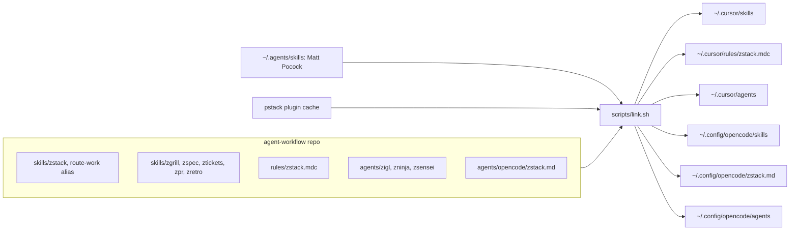
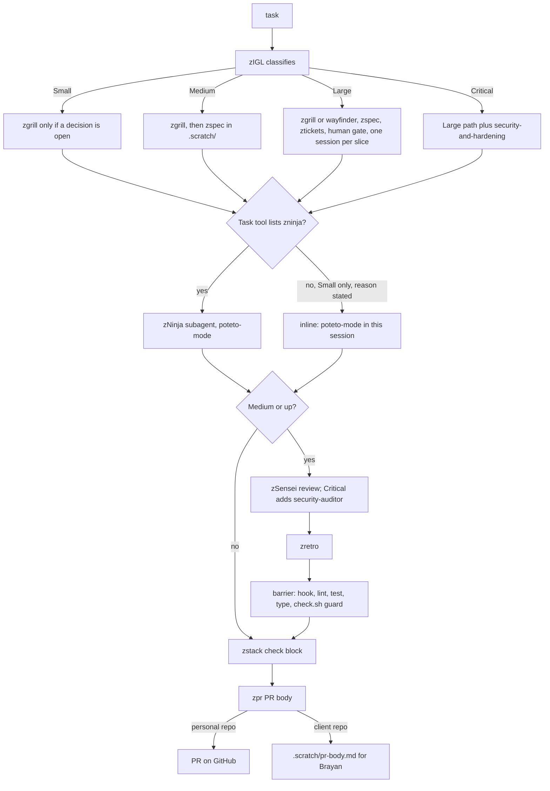
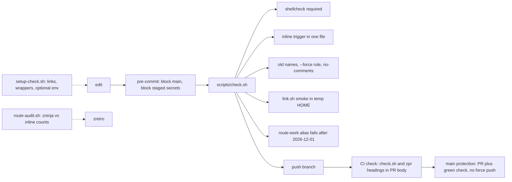

# Architecture

How this repo is wired and how a task moves through zStack. `skills/zstack/SKILL.md` is the source of truth; this page only draws it.

## 1. Repo to user folders

`scripts/link.sh` symlinks the repo into the folders Cursor and OpenCode read. It is idempotent, removes old links that point into this repo (route-work rule, implementer, code-reviewer, coordinator), sets `core.hooksPath` to `.githooks`, removes broken symlinks (only symlinks, never real folders) in `~/.cursor/skills` and `~/.config/opencode/skills`, and mirrors Matt's skills from `~/.agents/skills` and pstack skills when the name is free.

## 2. Task flow

`rules/zstack.mdc` is always on, so each session starts in zStack as zIGL. zIGL classifies the size and loads only that path. Matt's planning skills keep `disable-model-invocation`, so zStack calls them through wrappers that read Matt's file and add our rules. zNinja writes the code with poteto-mode; zIGL works inline only on Small, on the trigger in section 3 of the skill, and records the reason; Medium and up always go to zNinja (route-audit fails `medium+ inline`). zSensei reviews Medium and up. Client user stories start with section 0 of the skill: Jira and Confluence read-only, answers in `.scratch/answers.md`, attachments downloaded by hand into the task folder, work in a worktree from the company worktree tool on PATH (or a path defined only in local config); Brayan must approve the worktree before use, `.scratch/` and `.atl/` in `info/exclude` (written by `scripts/setup-check.sh`), and never `opencode/*` models. In every client task zIGL also loads the client KDBs from the local map `~/.config/zstack/clients.toml` (example: `docs/examples/clients.toml.example`), prints a `kdb:` line, zNinja follows them and stops on a conflict with the TechSpec, and zSensei reports `kdb-match` with evidence. zretro ends in a barrier, and zpr writes the PR body. Large, and a Medium promoted to Large, then follows the slice loop in the skill: one new session per ticket, checks, local commit, stop. A recovery plan does not replace that new session.

## 3. Guardrails

Each guard runs at a different moment. The pre-commit hook and CI run the same `scripts/check.sh`. GitHub protects `main`: a PR with a green `check` is the only way in. `setup-check.sh` and `route-audit.sh` are manual reports. `route-audit.sh` exits 1 when a zstack session has no parseable size (`size undetected`). The canonical line is `zstack: <Small|Medium|Large|Critical>, <full|partial> verifiable — <reason>`; older variants (`Clasificación **Small**`, `size: Small`) still count, reported as `legacy format`.

## Verified statechart

`docs/statechart/` holds a TLA+ model of this flow, checked with TLC via pstack's `/statechart` (decision #23). With option B every rule holds when the agent obeys the skill text; with no barriers (today) each rule breaks, so all six hold by text, not by a blocking hook. CI job `tla` reruns TLC when the skill or the model changes. See [docs/statechart/README.md](statechart/README.md) and [chart.mmd](statechart/chart.mmd).

## Hard barriers (opt-in)

| Barrier | What blocks | Install (Brayan) | Bypass |
|---|---|---|---|
| `hooks/client-guard/pre-push` | `git push` from any repo under the clients root (`CLIENTS_ROOT`, or `$HOME/Clients` when that is unset) or to a remote matching `CLIENT_GUARD_HOSTS` (default `bitbucket.org gitlab.`) | In each client repo, copy this repo's `hooks/client-guard/pre-push` into `"$(git rev-parse --git-path hooks)/pre-push"` (repos with husky or a local `core.hooksPath`: add it there instead). The hook does not read the client map | `CLIENT_PUSH_OK=brayan git push`, or `--no-verify` |
| `hooks/client-guard/pre-commit` | `git commit` in the same repos (path under the clients root, or an `origin` matching `CLIENT_GUARD_HOSTS`) | Same as pre-push, file `pre-commit`. Husky repos (`core.hooksPath=.husky`): add this repo's `hooks/client-guard/pre-commit` as a line in a local, untracked `.husky/pre-commit` only if Brayan wants it; never commit it to the client repo | `CLIENT_PUSH_OK=brayan git commit`, or `--no-verify` |
| Agent identity for merges | Nothing yet: the agent's GitHub token is Brayan's admin account | Give the agent its own GitHub identity (machine user or GitHub App) with write access; add a ruleset on `main` with **Restrict updates** and bypass list = repository admin (Brayan) | Brayan's account |

`scripts/setup-check.sh` reports them (`client-guard`, `client-guard pre-commit`, `merge-guard`, `local-exclude`, `client identity`). `local-exclude` is the count of client repos whose `info/exclude` contains `.scratch/` and `.atl/`; the same run appends any missing line and does not touch `.gitignore`. A mapped client fails when `git_email` is set and the effective `user.email` is not exactly that value. It warns when `git_email` is unset, `git_email_domains` is set, and the email matches none of those suffixes. A repo under the clients root with no matching `root` gets no identity fail or warn, and it still counts for client-guard and local-exclude. Agents never install the hook in client repos nor touch global git config. Agents may commit locally per slice in client repos (zstack section 5, "Client slice commits": loop slice → gate → commit → log; a commit plan and Brayan's ok only when uncommitted changes span several slices; a full pre-push gate before asking for push); if this pre-commit guard is installed it blocks them, and the agent stops and asks Brayan instead of bypassing it. Checks are detected, never invented; illustrative examples per stack: .NET commit `dotnet build` + `dotnet test --filter <slice>`, pre-push `dotnet build --no-incremental` + `dotnet test`; Node/TS `npm run lint`, `tsc --noEmit`, `npm test -- <slice>` / `npm test`; Go `gofmt -l`, `go vet`, `go test ./pkg/...` / `go test ./...`; Python `ruff check`, `pytest tests/test_slice.py` / `pytest`.
