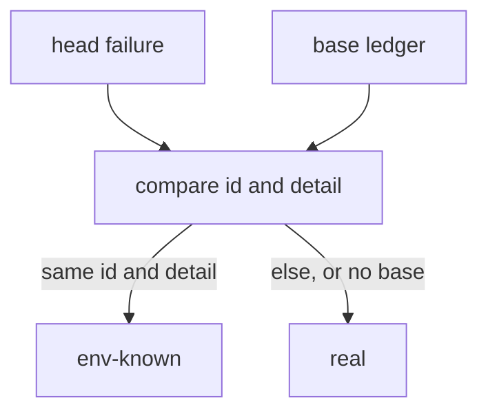

# Review package

Shape of the one delivery report in section 5 of `skills/zstack/SKILL.md`. Not a live task. Copy these fields into the `zstack check` block. Do not write a second report.

Read the flow from top to bottom. A check node names one evidence line. A check that did not run has no node and an explicit line. The drawing is not a result.

## Summary

```
read the head ledger and the base ledger
for each head failure:
  same id and same detail on the base: env-known
  otherwise: real
no base ledger: every head failure is real
```

## Flow

The compare step reads two ledgers. That interaction is drawn. Nothing runs concurrently, so there is no parallel branch.



Start at `head failure`, then `compare`. The evidence for `compare` is the classify command below. `env-known` and `real` are outcomes, not checks. The full suite did not run. It has no node.

## Evidence

The classify line is a real run of that command on the two fixture files. The full suite was not run. TDD was not used. When TDD was used, the `tdd` field carries the red command, the red result, the green command, and the green result from the pre-push log. Do not fill any of this from the diagram.

- `sh scripts/classify-test-failures.sh docs/examples/test-failure-fixtures/head-env.txt docs/examples/test-failure-fixtures/base.txt` → `env-known`, `net.timeout`, `dial timed out`, exit 0. Limit: those two fixture files.
- full suite → did not run: this example records one fixture command.
- tdd → not used

```
zstack check
- zstack invoked: yes
- size: <size>
- verifiable: <full|partial>
- not verified automatically: full suite → re-run the repo suite
- zninja launched: <yes | no (inline: <reason>)>
- poteto-mode loaded: <yes/no> (<zninja | inline>)
- reviewers: <none | zsensei | zsensei + security-auditor | inline self-check (small only) | independent (no Cursor)>
- summary: read the head ledger and the base ledger; same id and same detail on the base is env-known; otherwise real; no base ledger means every head failure is real
- flow: mermaid in this file; the two ledgers meet at compare; no concurrency
- evidence: sh scripts/classify-test-failures.sh docs/examples/test-failure-fixtures/head-env.txt docs/examples/test-failure-fixtures/base.txt → env-known, net.timeout, dial timed out, exit 0; limit: those two fixture files; full suite did not run
- tdd: not used
```
