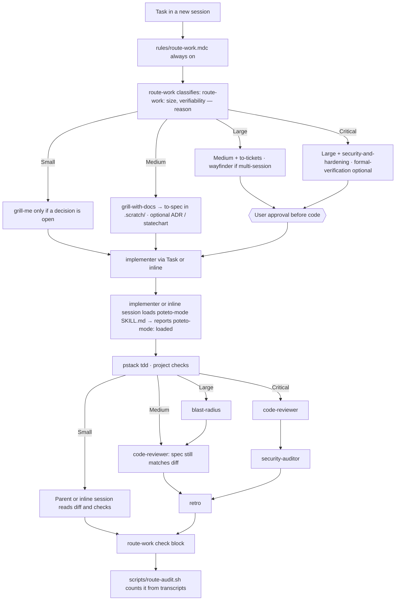

# Software factory

How one task moves through this setup, from intake to retro. `skills/route-work/SKILL.md` is the source; this page is the map.

Run inline when the Task tool is absent, or its subagent list does not include implementer, or one launch attempt returned an error (quote it in the reason), or this session is a whole task that arrived with no parent and is running headless without subagents; if the Task tool exists and lists implementer, you must launch it. That `impl` step then runs in the same session. The check block records `implementer launched: no (inline: <reason>)`. `scripts/route-audit.sh` counts delegated launches only; inline runs show as not launched.

## Where it is wired

| Harness | Always-on entry | Installed by |
| --- | --- | --- |
| Cursor GUI | `~/.cursor/rules/route-work.mdc` (`alwaysApply: true`) | `scripts/link.sh` (symlink) |
| Cursor CLI (`agent`) | same user rule, plus the repo's `AGENTS.md` | `scripts/link.sh` |
| OpenCode | `~/.config/opencode/route-work.md` listed in `instructions` of `opencode.json` | `scripts/link.sh` links the file; add the `instructions` entry once by hand |

## Fixed retro check

Every retro answers, with numbers from `scripts/route-audit.sh <project> <days>`:

- ¿Se invocó route-work?
- ¿implementer lanzó poteto-mode? (`poteto-mode: loaded` in its report)
