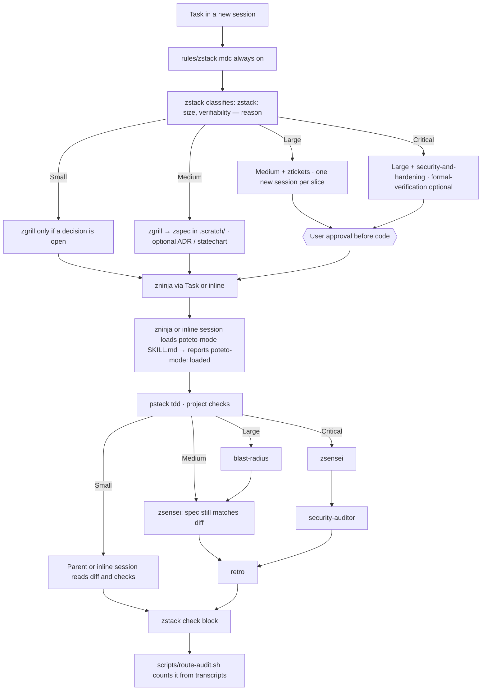

# Software factory

How one task moves through this setup, from intake to retro. `skills/zstack/SKILL.md` is the source; this page is the map. Section 1 of that skill applies the token budget before the size line. This map uses the printed size.

The Large `blast-radius` step runs `scripts/blast-radius-callers.sh` (`skills/blast-radius/SKILL.md`). The report lists every in-module caller, including private methods and indirect callers. The check fails when the report misses one.

The inline trigger is in section 3 of `skills/zstack/SKILL.md`. That `impl` step then runs in the same session. The check block records `zninja launched: no (inline: <reason>)`. `scripts/route-audit.sh` counts delegated launches only; inline runs show as not launched. Large repeats `impl` once per ticket, each in a new session (Slice loop in the skill). A recovery plan does not replace that new session.

## Where it is wired

| Harness | Always-on entry | Installed by |
| --- | --- | --- |
| Cursor GUI | `~/.cursor/rules/zstack.mdc` (`alwaysApply: true`) | `scripts/link.sh` (symlink) |
| Cursor CLI (`agent`) | same user rule, plus the repo's `AGENTS.md` | `scripts/link.sh` |
| OpenCode | `~/.config/opencode/zstack.md` listed in `instructions` of `opencode.json` | `scripts/link.sh` links the file; add the `instructions` entry once by hand |

## Fixed retro check

Every retro answers, with numbers from `scripts/route-audit.sh <project> <days>`:

- ¿Se invocó zstack?
- ¿zninja lanzó poteto-mode? (`poteto-mode: loaded` in its report)
