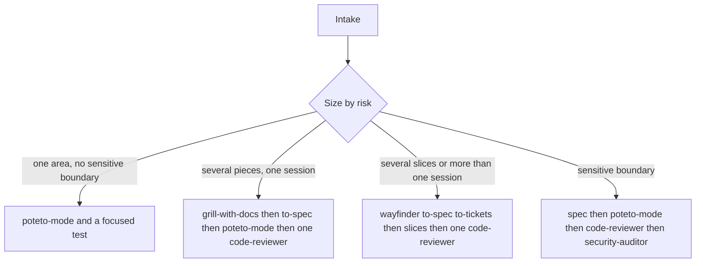
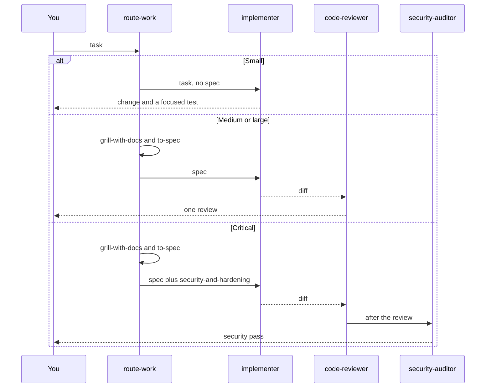

# Workflow

Size picks the path. Risk outranks file count. Auth, permissions, personal data, payments, a new secret or credential, or a new integration is critical at any file count.

`skills/route-work` classifies and calls only that path. `agents/coordinator.md` does this on Cursor. It does not implement. On OpenCode, Sisyphus may split a large change, and it follows the same skill. It does not open the other installed routers. This repo does not rewrite Sisyphus on disk.

Engineer Lead, on the outer loop, can split work before it arrives. It does not implement. Dr Eggbot designs bots and stays outside this chain.

Herdr is a later check that a Cursor CLI pane and an OpenCode pane can sit together. This path does not open panes.

## How a change moves

A sensitive boundary is critical at any file count. It does not re-enter the medium or large stop checks.

## Paths

- **Small.** One clear area, one session, no sensitive boundary. `grill-me` only if a decision is open. Then `poteto-mode`. A focused test if behavior changes. No spec. No PRD, Figma, or Stitch unless the user points at one. No `code-reviewer`, no `security-auditor`.
- **Medium.** Several pieces, one session, and none of the critical boundaries. `grill-with-docs`, then `to-spec`. `prd-td-coherence` only when a PRD and a design already exist. `poteto-mode` with pstack's `tdd`. `code-reviewer` loads `code-review-and-quality` once. `retro` once. Read a visual reference only when one exists.
- **Large.** Several slices or more than one session, and none of the critical boundaries. `grill-with-docs` or `wayfinder`, then `to-spec` and `to-tickets`. A human gate before code. Slices go to `implementer`. Then `blast-radius`, the same `code-reviewer`, and `retro`.
- **Critical.** Auth, permissions, personal data, payments, a new secret or credential, or a new integration, at any file count. Its own sequence: `grill-with-docs`, `to-spec`, `poteto-mode` with `security-and-hardening`, `code-reviewer`, then `security-auditor`. It does not stop at the medium or large boundary check.

## Examples

A button label change is small. The task is already clear, so `grill-me` is skipped. `poteto-mode` edits it. No spec and no review agent.

A one-session feature with two states and an unclear empty case is medium. `grill-with-docs` settles the empty case, `to-spec` writes it down, `poteto-mode` builds it, and `code-reviewer` reads the diff.

A change that stores a new personal-data field is critical whether it is a few lines or several files. It follows the critical sequence: a spec, `poteto-mode`, `code-reviewer`, then `security-auditor`.

## Not loaded

Installed skills and agents that this path does not call stay on disk. Other repos may still name them. The list is in `docs/value-review.md`.
